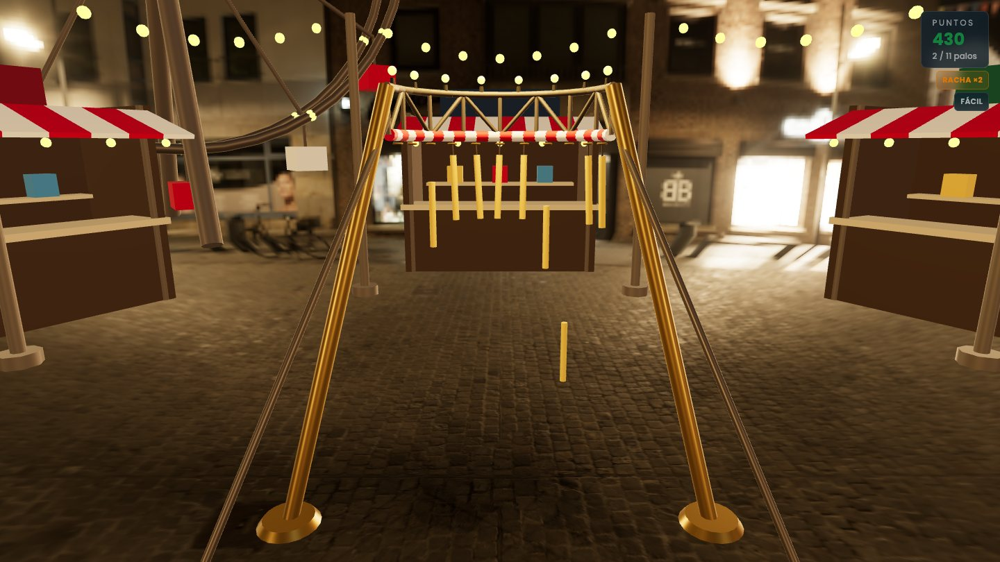

# Stick Rush

A browser and mixed-reality game: sticks hang from a fairground machine, drop one after another
in random order, and you have to catch them before they hit the ground.

**Play it:** <https://stick-rush.vercel.app>



The machine is a **horizontal semicircular hoop** and the player stands at its centre, so the
sticks fall all around them, within arm's reach. The whole scene is at human scale (1 unit =
1 metre). Stick Rush is one of the cabinets of the [xrcade](https://github.com/1to1-Digital-Solutions/xrcade)
hall, and it also runs on its own as this website.

## How to play

1. Pick the mode. The menu opens on **Challenge**, the one that counts for a medal: three lives,
   one per stick lost, always thirteen sticks on Medium so that two scores are the same run.
   **Practice** (every stick drops, missing costs nothing, optionally endless) and **Levels** (one
   level at a time, each unlocks the next) are on the same mode switch. The challenge can also be
   played by **two players** taking turns with the same seed.
2. In practice, "More options" lets you pick how many sticks you want, **between 5 and 13**, and
   the speed: Easy, Medium, Hard, Expert or Impossible.
3. Press **Play**. A three-second countdown runs first, and then the sticks drop one at a time in
   random order.
4. Catch what you can. A stick can be taken at any time until it touches the ground, **including
   while it still hangs from the hoop**.

Each stick is worth 100 points multiplied by the difficulty, by the streak of sticks caught
without missing and by your reflexes (the earlier in its fall, the more). The arithmetic is in
`src/lib/scoring.ts`. The best score of each mode is kept in the browser's `localStorage`.

| Where | How you catch |
| --- | --- |
| Desktop or mobile browser | Click or tap the stick |
| XR headset, with controllers | Close your hand around the stick and squeeze the **grip** button |
| XR headset, with bare hands | Pinch your fingers on the stick |

In a headset you do **not** catch sticks by pointing at them: the ray only operates the menu.
There is a single button to enter the headset; inside, the menu lets you choose between the
fairground and your own room (passthrough), where the headset offers it. The first run in a
headset comes with a short tutorial.

The interface is in English and Spanish. The language, the volumes, the scenery and the good hand
are the hall's settings (`src/lib/settings.ts`) and the game reads them.

## Running it locally

The Node version is pinned in [`.nvmrc`](.nvmrc) (`nvm install` or `fnm use --install-if-missing`
reads it).

```bash
npm install
npm run dev        # dev server at http://localhost:3000
npm run dev:https  # the same over HTTPS, which WebXR requires on a headset
npm run build      # production build
npm run start      # serve the production build
```

The game depends on no external service: no environment variables, no database, no third-party
requests at run time. The assets are served from `public/`.

### On a headset

WebXR requires a secure origin. Run `npm run dev:https`, find your machine's IP on the local
network, and on the headset's browser open `https://<your-ip>:3000` (the computer and the headset
on the same Wi-Fi), accept the self-signed certificate and press the button to enter the headset.

## How it fits the xrcade hall

The repository holds two things: **the game**, a React package that mounts wherever it is put
(`src/game`, `src/components`, `src/lib`), and **its own site**, a thin Next.js app that mounts
it full screen (`src/app`). The hall installs the game at a fixed version (a repository tag),
copies its static files with `npx stick-rush-assets <dir>` and mounts it as a scene inside its
own Canvas and immersive session:

```tsx
import { StickRushScene } from 'stick-rush'

<StickRushScene assetsBase="/juegos/stick-rush/" onExit={onExit} />
```

The hall can also pass a seeded `challenge`, the medal thresholds (`goal`), the cabinet's `name`
and an `onFinish` callback that receives the result of each run. The full contract —install,
`transpilePackages`, assets, Tailwind, the two ways of mounting and what the game expects from
its host— is in [`docs/mounting-the-game.md`](docs/mounting-the-game.md).

[`godot/`](godot/README.md) holds a port of the game to Godot that runs the same `src/lib` logic
through GodotJS, built on the hall's Godot kit.

## Stack

- [Next.js 16](https://nextjs.org) (App Router), React 19, TypeScript
- [React Three Fiber](https://docs.pmnd.rs/react-three-fiber), [drei](https://github.com/pmndrs/drei)
  and [three.js](https://threejs.org) for the 3D scene; [@react-three/xr](https://github.com/pmndrs/xr)
  for the immersive session (WebXR)
- Tailwind CSS v4 for the DOM interface
- [Vitest](https://vitest.dev) (unit) and [Playwright](https://playwright.dev) (end-to-end)

Sound effects are synthesised with the Web Audio API (`src/lib/sound.ts`); the background music
is a file. The security headers (CSP, `Permissions-Policy`) are declared in `next.config.ts`.

## Tests

```bash
npm run lint       # ESLint
npm run typecheck  # type checking
npm test           # unit tests (Vitest)
npm run coverage   # the same, with coverage: src/lib has to stay at 100 %
npm run test:e2e   # end-to-end (Playwright; builds and starts its own server)
npm run capture    # regenerates docs/gameplay.jpg, the screenshot of this README
```

Playwright needs its browser the first time: `npx playwright install chromium`.

The unit tests cover the logic in `src/lib` and the panels of the immersive interface. The
end-to-end tests drive the real game in Chromium against the production build. Chromium has no
WebXR, so the immersive paths run against an emulator the suite installs itself (a headset
emulated with [IWER](https://github.com/meta-quest/immersive-web-emulation-runtime), in
`e2e/support/`). The suite is served from `127.0.0.1` rather than `localhost` on purpose:
`@react-three/xr` injects its own emulator when the hostname is exactly `localhost`.

### Scripts that need the sibling repositories

A few scripts reach outside this repository, into repositories that are private. Without them
these scripts stop with a message that says which file is missing; everything above works
without them.

| Script | Needs |
| --- | --- |
| `npm run godot:build`, `godot:sfx`, `godot:controllers` | The xrcade hub checked out next to this repository (`../xrcade`), for its Godot kit (`../xrcade/godot-kit`) |
| `npm run godot:test` | The same, plus a Godot 4.7.1 editor built with GodotJS, given in `$GODOT` |
| `npx tsc -p godot --noEmit` | `../xrcade/godot-kit` (the Godot `tsconfig` extends it) and the generated `godot/typings/` |
| `npm run comunes` | Organízate, the suite that checks the files shared by every game of the hall (`organizate/scripts/repos/comunes.py`, two levels above the git directory) |

`npm run sync:xr-profiles` needs nothing external: it copies the WebXR controller profiles from
`node_modules/@webxr-input-profiles/assets` again, and its output is committed.

## Layout

```
src/
  app/          The game's own site: a thin wrapper around <StickRush>
  game/         What the package offers: StickRush, StickRushScene, mountStickRush, styles.css
  components/   The scene (game/), the DOM menu (ui/) and the immersive interface (xr/)
  lib/          The logic, pure and tested without a browser: layout, scoring, modes, store
e2e/            Playwright tests, and the WebXR emulator they install
godot/          The Godot port (see godot/README.md)
docs/           The mounting contract and the README screenshot
public/         Static assets (see public/CREDITS.md)
scripts/        The assets copier (stick-rush-assets) and the profile sync
```

## Credits

Third-party assets, all served from `public/` and listed with their origin in
[`public/CREDITS.md`](public/CREDITS.md) (the Godot package carries the same ones, in
[`godot/games/stick-rush/CREDITS.md`](godot/games/stick-rush/CREDITS.md)):

- **Sky and reflections**: Night Environment HDRI 009 by [ambientCG](https://ambientcg.com/view?id=NightEnvironmentHDRI009), CC0.
- **Wood of the sticks**: Fine Grained Wood by [Poly Haven](https://polyhaven.com/a/fine_grained_wood), CC0.
- **Stalls, lamp posts and banners**: Fantasy Town Kit 2.0 by [Kenney](https://kenney.nl/assets/fantasy-town-kit), CC0, through the hall's shared kit.
- **Music**: Upbeat Chiptune Theme by nihilocrat ([OpenGameArt](https://opengameart.org/content/upbeat-chiptune-theme)), CC0.
- **Hands, controller profiles and Quest controller models**: [@webxr-input-profiles/assets](https://github.com/immersive-web/webxr-input-profiles), MIT (Copyright (c) 2019 Amazon); the notice is in `public/CREDITS.md`.
- **Fonts** of the website: Righteous and Poppins, loaded with `next/font/google` at build time.

## Licence

[MIT](LICENSE) © 1to1 Digital Solutions.
