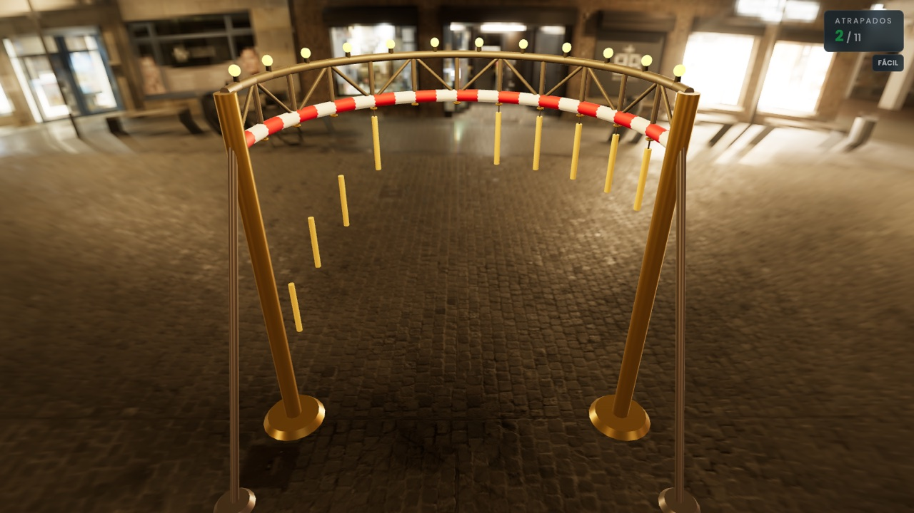

# Stick Rush

A browser and mixed-reality game: sticks hang from a fairground machine, drop one
after another at random intervals, and you have to catch them before they hit the
ground.



The machine is a **horizontal semicircular ring** and the player stands at its
centre, so the sticks fall all around them, within arm's reach, instead of onto
their head. The whole scene is at human scale (1 unit = 1 metre).

## How to play

1. Pick the mode — **Práctica** (practice) or **Desafío** (challenge).
2. Pick how many sticks you want, **between 5 and 13**.
3. Pick the difficulty — **Fácil, Medio, Difícil, Experto or Imposible** (easy to
   impossible) — which sets the fall speed: from about 5.7 s per stick on Fácil to
   under 1 s on Imposible.
4. Press **Jugar** (play). A **three-second countdown** runs first — the sticks
   hang there in plain sight but nothing can be taken yet — and then they drop one
   at a time in **random order**, with a random gap between them: where a stick
   hangs says nothing about when it falls. In the browser the count is a big
   number over the scene; in a headset it is three rings that go out one per
   second, since there is no text in there.
5. Catch what you can. A stick can be taken any time between the start of the round
   and the moment it hits the ground, **including while it still hangs from the
   ring** — getting ahead of a stick is playing, not cheating. Once it lands it
   stays on the floor, red, as a tally of what got away; it cannot be picked back
   up. The round ends once every stick is resolved (caught or dropped) and the
   score screen shows the result.

**What a stick is worth.** The score is not how many you caught: each stick is
100 points multiplied by three things, and all three pay for playing better
rather than longer. The **difficulty** you picked (×1 on Fácil up to ×5 on
Imposible), the **streak** of sticks caught without missing (+15% each up to
×2.5, and one miss cuts it back to nothing) and your **reflexes** — taking a
stick the moment it drops is worth double what rescuing it just above the floor
is, and one still hanging from the ring counts as the best case. While you play,
the scoreboard shows the points, the sticks caught out of the total and the
streak once it is worth showing; the score screen adds the most that round could
have given, so the figure has a scale, and your best streak. The whole formula is
plain arithmetic in `src/lib/scoring.ts`, tested without a browser.

**The two modes.** In *Práctica* every stick falls and missing one costs nothing:
it is the game as it always was, to warm up. In *Desafío* you play with **three
lives** — every stick that reaches the floor costs one, and the round is over when
you run out of them (even with sticks still hanging) or when you clear them all.
The lives you have left are on the scoreboard while you play, in the browser and in
the headset, and the score screen ends with the score **and the lives you finished
with**. Difficulty is unchanged by the mode: it is still yours to pick, and it is
still what the scoring scales with. Lives are three regardless of sticks or
difficulty, because those two are already the knobs that grade a round.

Your **best score** is kept between rounds and between visits, and beating it is
announced on the score screen. There is **one record per mode**: a challenge stops
when the lives run out, so with a single record the mode with something at stake
would be the only one that could never beat it. In a headset the record is a mark
on the score bar rather than a figure — same reason as the rest of the immersive
UI: no text.

**Sharing the result.** The score screen has a share button in both modes: it hands
the system a short line with the score, the mode, the difficulty, the sticks caught
and — in *Desafío* — the lives you finished with, plus a link to the game. It uses
the **Web Share API** where there is one and falls back to the **clipboard**, saying
so, which is what makes the button answer inside a headset too: an immersive session
may have nowhere to draw the system sheet, and there the text is left copied instead.
Cancelling the sheet is not an error. Nothing is uploaded and no one else's score is
ever stored: sharing is sending a line of text, not publishing a leaderboard.

> The game's interface is in Spanish, which is the product language.

| Where | How you catch | What you see |
| --- | --- | --- |
| Desktop or mobile browser | Click or tap the stick | The machine in the fairground, camera behind the player |
| XR headset | **Grab it with your hand** (squeeze button) | The fairground all around, or just the machine over your real room (passthrough) |

There is a single way in — one button, **Entrar en el visor** — and the choice
between the fairground and your own room is made *inside*, from the immersive
menu, as often as you like. It used to be two buttons, one per mode, which tied
the decision to before you put the headset on and gave no way back: WebXR cannot
turn an `immersive-vr` session into an `immersive-ar` one without closing it and
opening another. So the game always enters `immersive-ar` where the headset has
it, and the two "modes" are the same session painted two ways.

In a headset you do **not** catch sticks by pointing at them. The ring sits within
arm's reach and you close your hand around a stick as it falls: the grab pointer is
a sphere attached to your fist, triggered by the squeeze button. The aiming ray is
still there, but only to operate the menu — pointing at a stick does nothing.

There is no DOM in an immersive session, so the menu is built out of geometry and
shown in front of you when you enter the headset: a row of sticks to pick how many
you want, five tiles with growing bars for the difficulty, a switch with three
hearts that turns the challenge on, a pair of tiles to choose between the
fairground and your own room, and a play button. **Not a single letter** — `<Text>`
would pull fonts from a CDN, and the game has to run on a headset with no internet
access, so every control is drawn as the thing it means.
A back button is always within reach during a round, and when it ends you choose
between replaying, sharing the result and going back to the menu. The share button
answers on the spot — a tick if the result went out, a cross if the headset would
not let it — because inside a session there is no system toast to tell you.

## Stack

- [Next.js 16](https://nextjs.org) (App Router) + React 19 + TypeScript
- [React Three Fiber](https://docs.pmnd.rs/react-three-fiber) + [drei](https://github.com/pmndrs/drei) + [three.js](https://threejs.org) for the 3D scene
- [@react-three/xr](https://github.com/pmndrs/xr) for immersive sessions (WebXR)
- Tailwind CSS v4 for the DOM UI
- [Vitest](https://vitest.dev) (unit) and [Playwright](https://playwright.dev) (end-to-end)

The game **depends on no external service**: no environment variables, no database,
no third-party requests. Assets (HDRI and textures, all CC0) are served from
`public/`; see [`public/CREDITS.md`](public/CREDITS.md). So are the WebXR controller
profiles, which used to be fetched from a CDN and are now part of the site — see
[XR mode](#xr-mode).

Sound is **synthesised** with the Web Audio API rather than played back from audio
files — a handful of oscillators, so there is nothing to download and no
`media-src` to open up in the CSP. Catching a stick rings a short chime that goes
up a semitone per stick in your streak, losing one drops a low buzz, and each
second of the countdown ticks, rising as the start approaches. It only starts
after your first click — pressing Enter on a button counts, since that fires one
too: browsers refuse to play audio before that.
Both menus — the desktop one and the immersive one — can mute it, and while
muted the game never touches the Web Audio API at all. **The choice is
remembered between visits** (`src/lib/mutePreference.ts`): in a headset, muting
again every time you put the visor on is the most tedious gesture in the game.
The scenery choice is remembered the same way
(`src/lib/sceneryPreference.ts`), and for the same reason. It never overrides
what the session can actually do: a stored `passthrough` opening as
`immersive-vr` still gets the scenery, because behind that one there is no real
room — only black.

That is all the game ever writes to the browser — the best score (one integer
per mode, `src/lib/highScore.ts`), the ring height correction
(`src/lib/hoopHeight.ts`), whether the in-headset tutorial has been seen
(`src/lib/tutorial.ts`), the scenery and this — six `localStorage` keys once you
count a best score per mode, all of them local preferences with nothing that describes
who is playing, no cookies and nothing that leaves the device. With storage unavailable — private mode, or a headset
with it blocked — there is no record to show and nothing is remembered for next
time, but everything still works: muting included, for as long as the visit
lasts.

In a headset the game also **speaks through the controllers** (WebXR haptics),
played through `XRInputSource.gamepad.hapticActuators`, so there is nothing to
download here either. It is the one cue that still reaches you while you are
looking at another stick with the sound muted. Catching a stick is a short, firm
pulse on the hand that caught it; missing one is longer and softer — nobody
touched it, so it goes to both hands — and pressing a button in the immersive
menu gives the briefest tap of the three, because from a metre away your hand
touches nothing. Bare hands and the desktop mouse have no actuator, so they
simply do not vibrate.

It is a fully static site — no middleware, no Server Actions, no API routes. Security
headers (CSP, `Permissions-Policy`, HSTS and friends) are declared in
`next.config.ts`; `connect-src 'self'` is what enforces the "no external requests"
promise, and `xr-spatial-tracking=(self)` is what keeps WebXR working. Both are
covered by tests in `e2e/seguridad.spec.ts`.

## Embedding the game

The repository holds two things: **the game**, a React component that mounts wherever
you put it (`src/game`, `src/components`, `src/lib`), and **its own site**, a thin
Next app that mounts that component full-screen (`src/app`). The game knows nothing
about routes, layout, metadata or deployment, so another application — the
[xrcade](https://github.com/1to1-Digital-Solutions/xrcade) hub — can load it *inside*
itself instead of linking out to it, which is what breaks the immersive session.

```tsx
import { StickRush } from 'stick-rush'
import 'stick-rush/styles.css'

<div className="h-dvh w-full">
  <StickRush assetsBase="/juegos/stick-rush/" />
</div>
```

It is consumed at a fixed version (a repository tag), and the static files it needs
are copied with `npx stick-rush-assets <dir>`. The full contract — install,
`transpilePackages`, assets, Tailwind and what the game expects from its host — is in
[`docs/montar-el-juego.md`](docs/montar-el-juego.md).

## Development

The Node version is pinned in [`.nvmrc`](.nvmrc), and CI reads it from there. It pins an
exact patch, so run `nvm install` (or `fnm use --install-if-missing`) before installing:
both read the file and fetch the version if the machine does not have it yet. The
`package-lock.json` format changes between npm versions, so installing on an older Node
rewrites the lockfile for nothing.

```bash
npm install
npm run dev        # dev server at http://localhost:3000
npm run dev:https  # same, over HTTPS (required to test WebXR on a headset)
npm run build      # production build
npm run start      # serve the production build
```

One more script stays out of the day-to-day: `npm run sync:xr-profiles` re-copies the
WebXR controller profiles into `public/webxr-profiles/`. Its output is committed, so a
clone needs nothing extra and it is only worth running when
`@webxr-input-profiles/assets` is updated — the why is in [XR mode](#xr-mode).

### Checks

```bash
npm run lint       # ESLint
npm run typecheck  # type checking
npm test           # unit tests (Vitest)
npm run test:e2e   # end-to-end (Playwright; builds and starts the server)
npm run capture    # regenerates docs/partida.jpg, the screenshot in this README
```

Playwright needs its browser the first time: `npx playwright install chromium`.

The unit tests cover the logic in `src/lib` — machine geometry, stick layout and
release delays, fall times per difficulty, what a catch is worth, the gaze anchor
of the immersive UI, and the round lifecycle. The e2e tests drive the real game in
Chromium against the production build: menu, round, catching sticks with the mouse,
game over, the challenge and its lives, the record, sharing the result, sound, the
security headers, behaviour on a phone-sized screen, and what the fairground costs to
draw (`e2e/recinto.spec.ts` counts the WebGL draw calls per frame, which is what a
headset pays for — see `ESTADO.md`).

Chromium has no WebXR, so the immersive paths (`e2e/xr.spec.ts`: entering the
headset, the first-time tutorial, the ring height being remembered) run against an
**emulator the suite installs itself**, a Quest 3 emulated with IWER and bundled
before the run (`e2e/support/`). It hands over a session and two input sources, but
its pointers never reach the objects in the scene, so **catching a stick and pressing
a 3D button can still only be proved on real hardware**. That is a limit, not an
excuse: it once hid a real bug — the controllers were never registered, because their
profile came from a CDN the CSP blocks — so there is now a test watching the console
inside the session.

The suite is served from `127.0.0.1` rather than `localhost` on purpose:
`@react-three/xr` injects that same emulator on its own when the hostname is exactly
`localhost`, which adds an "Enter XR" button that does not exist in the real game.
The XR tests install theirs explicitly instead, so what they exercise is the game's
own entry button.

## Layout

```
src/
  app/                  The game's own site: a thin wrapper around <StickRush>
    layout.tsx          Root layout: fonts (Righteous + Poppins) and metadata
    page.tsx            Mounts the game full-screen
    game/page.tsx       Direct route to the same screen
    global-error.tsx    Global error boundary
    globals.css         Page styles (the game's own live in src/game/styles.css)
  game/                 What the game offers to whoever mounts it
    index.ts            Public entry point: StickRush, mountStickRush
    StickRush.tsx       The game as a component, with its options
    mount.tsx           The same, onto a DOM element
    styles.css          Colours, typography and screen animations
  components/
    GameProvider.tsx    Provides the game context
    ui/StartScreen.tsx  Menu overlay (mode, sticks, difficulty, play, headset)
    game/               R3F canvas (always mounted), machine, sticks, ground, HUD, sound wiring
      SceneryFade.tsx   Curtain that hides the swap between fairground and passthrough
    xr/                 WebXR store, entry button, immersive menu, 3D HUD
      XRController.tsx  The controller in your hand, with the grab and ray pointers
      XRGazeAnchor.tsx  Holds the immersive UI in front of the player's eyes
      XRCountdown.tsx   The countdown as rings, one per second, because there is no text
  lib/
    gameConfig.ts       Constants: difficulties, speeds, colours, geometry
    gameStore.ts        Global game state (Context API)
    gameMode.ts         Practice or challenge: lives and how a round ends
    scoring.ts          What a stick is worth: difficulty, streak and reflexes
    highScore.ts        Best score per mode, kept between visits
    hoopHeight.ts       Ring height for the player: headset, manual tweak, limits
    xrAnchor.ts         Angle maths behind the gaze anchor: deadzone and follow
    stickLayout.ts      Stick layout, shuffled fall order and score token states
    sceneryLayout.ts    Fairground layout: stall ring, light garlands, ferris wheel
    shareResult.ts      Result text (pure) and the share sheet / clipboard fallback
    stickSwing.ts       Idle sway of the hanging sticks
    sound.ts            Synthesised game sounds (Web Audio, no files)
    mutePreference.ts   The mute choice, kept between visits
    tutorial.ts         Whether the in-headset tutorial has been seen
e2e/                    Playwright tests, and the WebXR emulator they install
docs/                   README screenshots and the mounting contract
public/
  hdri/, textures/      CC0 assets served locally (see public/CREDITS.md)
  webxr-profiles/       Controller profiles, served by the game instead of a CDN
scripts/                The assets copier (stick-rush-assets) and the profile sync
godot/                  Desktop Godot port (frozen, see godot/README.md)
```

Only what is worth naming is listed: `src/lib` also holds the smaller helpers
(haptics, asset paths, `localStorage` access, and the icons and measurements of
the immersive UI).

Game state lives in a **Context API** store (`gameStore`), with no external library.
It keeps only what the player decides — stick count, difficulty, mode, points, caught,
resolved and the phase — and **derives** "round over" from the resolved sticks, so
there are never two sources of truth to keep in sync. The pure logic (where each stick
hangs, when it drops, what catching it is worth, how the score is rendered) lives in
`src/lib`, outside the 3D components, which is what makes it testable without a
browser.

## XR mode

There is a **single entry button**, and it only shows up if the device supports
WebXR (`navigator.xr`). It opens an `immersive-ar` session where the headset offers
one and falls back to `immersive-vr` where it does not; what tells the two "modes"
apart is nothing but what gets drawn around the machine (`scenery` in the store),
which is what lets the player change their mind without leaving the session. Where
there is no passthrough to give, the option is shown disabled rather than lying.

`@react-three/xr` registers two pointers per controller and the game treats them
differently: the **grab** pointer (a sphere on your fist, fired by the squeeze
button) is what catches sticks, while the **ray** only drives the menu. `Stick`
decides that by looking at the event's pointer type, so a stray ray can never catch
anything. The mouse keeps working untouched, which is how you play on desktop.

The models `@react-three/xr` ships are disabled on purpose: it downloads them from
`cdn.jsdelivr.net`, and the game must work on a headset with no route to the
internet — the CSP blocks it anyway. Turning them off left the hands invisible, so
the controller is drawn here out of four primitives
(`components/xr/XRControllerModel.tsx`), with its squeeze trigger lit until you
catch your first stick: that is how the grab button gets taught. The tutorial —
shown once, the first time you put the headset on — and the button that replays it
use that same drawing, because teaching one controller and handing over another
would be teaching nothing.

What could not simply be turned off is the **controller profile**, the description of
which button is which: without it the library never registers the controller at all —
no model, no ray, no grab pointer — and it swallows the failed download in a
`.catch(console.error)`, so on the headset it was just no controllers and nothing to
press. They are served by the game itself instead (`public/webxr-profiles/`): the
`profile.json` files only — 528 KB — and none of the `.glb` models, which are the
100 MB of that package and are exactly what is drawn by hand above. Whoever mounts
the game elsewhere has to serve them too, which is why `npx stick-rush-assets` copies
them along with the HDRI and the textures.

The `<Canvas>` with `<XR>` is **always mounted**: the desktop menu and HUD are DOM
overlays on top of the 3D scene. That way, pressing "Entrar en el visor" starts the
session with the scene already in the tree and it shows up inside the headset.
`<XROrigin>` places the player's feet at the centre of the semicircle, at 1:1 scale,
with the ring just above head height and within arm's reach.

The immersive UI hangs from the player's **gaze**, not from that origin: the −Z of
the reference space is whatever the room was calibrated to, so entering while
looking elsewhere used to leave the menu behind your back, invisible and impossible
to aim at. It follows with a deadzone — turn your head a little and it stays put, so
the ray has something still to point at; turn away for real and it comes round with
you. The angle maths lives in `src/lib/xrAnchor.ts` and is tested without a browser
or a headset, which is exactly what could not be done with the pointers.

**The ring follows the player's height**, because standing, sitting or being short
changes the reach entirely. It is placed 35 cm above the eyes — the relation the
machine was designed around — reading the headset height while the immersive menu
is up, and it is left alone once sticks start falling. That reading only counts
when the session brings a floor-level reference space: in a `local` one the head
starts at zero and its height says nothing about the player. The top row of the
immersive menu corrects it by hand within ±20 cm, which is what the arm allows,
and the correction is remembered in `localStorage`. Fall speed is scaled with the
travel so that raising the ring does not hand out extra reaction time. All of it
lives in `src/lib/hoopHeight.ts`, tested without a browser.

With the **fairground** on, the machine stands in a set built out of geometry: stalls
in a ring around the player, light garlands strung between posts and a slowly turning
ferris wheel in the distance, with the HDRI behind them as sky and light. A photo has
no parallax, so on its own it gives itself away as soon as the player moves their
head. The whole set is instanced into a handful of draw calls (see
`lib/sceneryLayout.ts`). This is also what the browser always draws: there is nothing
to reveal behind it there.

With **passthrough** on, neither the fairground, the background, the ground nor the
environment is drawn: the set is the player's own room and covering it would break
passthrough. The HDRI is kept only as a reflection source, so the machine does not
look flat against the real room. Switching between the two would be brutal done in
one frame — a night-time square becomes your living room — so a curtain closes
around the player's head, the set changes while it is shut, and it opens again
(`components/game/SceneryFade.tsx`).

### Testing on a Quest headset

WebXR requires a secure origin, so opening the game from the headset's browser over
the local network needs HTTPS:

1. Start the server over HTTPS: `npm run dev:https`. The first time, Next generates and
   trusts a local self-signed certificate (no extra dependencies needed).
2. Find your machine's IP on the local network (e.g. `ipconfig getifaddr en0` on
   macOS). The computer and the headset must be on the **same Wi-Fi network**.
3. On the Quest browser open `https://<your-ip>:3000`.
4. Accept the self-signed certificate warning ("advanced" → proceed).
5. Press **Entrar en el visor** and grant the WebXR permissions. Pick your options in
   the floating menu — including whether you want the fairground or your own room
   around you — press play, and **squeeze** the grip button with your hand around a
   stick to catch it.

> Desktop mode still works with `npm run dev` (HTTP): menu → Jugar and click with the
> mouse to catch.

If deployed to Vercel, open the **direct URL** on the headset rather than the
dashboard preview: that one is embedded in an iframe, and WebXR needs
`allow="xr-spatial-tracking"` on the parent iframe.

## Project status

`ESTADO.md` is the handoff between sessions (in Spanish): what is done, what is
verified and what comes next. XR controller interaction is implemented but **not yet
validated on real hardware**.
